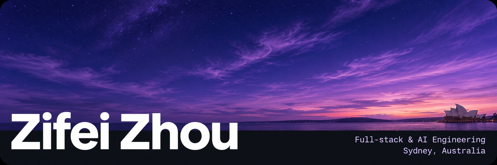

I’m a Computer Science student at UNSW and a full-stack engineer at Blotz. I build mobile and web apps, RAG assistants, and tools for evaluating LLMs.

[LinkedIn](https://www.linkedin.com/in/zifei-zhou-881a84337/)

## Building at Blotz

**Full-stack Engineer** · Jun 2026–present · [blotztask.com](https://www.blotztask.com/en/)

I ship features for a task-planning app on iOS and Android. I rebuilt React Native flows across seven screens, maintain the .NET APIs for scheduling and notifications on Azure, and improved AI response quality through prompt and schema changes.

| 4,000+ | ~30% fewer | 15% fewer |
| :--- | :--- | :--- |
| App downloads | Reported UI issues | Malformed AI responses |

## Tech stack

| Area | Tools and techniques |
| :--- | :--- |
| Languages | `TypeScript` `Python` `C#` `JavaScript` `SQL` |
| Web & mobile | `React` `Next.js` `React Native` |
| Backend & data | `FastAPI` `.NET Web API` `Node.js` `PostgreSQL` `pgvector` `Drizzle` `Prisma` |
| AI & evaluation | `OpenAI API` · Agent orchestration · RAG · Embeddings · Structured outputs · LLM evaluation |
| Cloud & delivery | `Azure` `Docker` `Git` · CI/CD |

## Experience

**Makesales · Frontend Intern**

Jan–Jun 2026

Built a RAG assistant that answers construction project managers’ questions about their project data, and a React dashboard that uses an LLM to create charts. Shipped 20+ reusable React components and worked with design to shorten onboarding from seven steps to three.

**ByteDance (TikTok) · LLM Evaluation Analyst**

Nov 2025–Jan 2026 · Project-based

Designed evaluation suites for reasoning, code generation, and safety. Wrote Python scoring scripts and adversarial cases that surfaced hallucinations, instruction-following failures, and multilingual regressions.

## Selected projects

- **[ADHD Timebox](https://landing-page-for-adhd-timebox.onrender.com/)** · Google Hackathon finalist. An AI planner that breaks tasks into timeboxes and replans the rest of the day in one tap. Built with Next.js and FastAPI.
- **[Involution Hell](https://involutionhell.com/)** · A computer science learning platform with interactive roadmaps and serverless APIs, built for 400+ users.
- **[Airtable Clone](https://at-clone-app-lyra.vercel.app/)** · A spreadsheet-style app with virtualised tables, keyboard navigation, and data validation. Built with Next.js, tRPC, and Prisma.

## Hackathons

- **Lyrathon 2025 · Best Creativity Award** — Tech lead on a full-stack app delivered in 48 hours.
- **Cursor Hackathon 2025 · Best Frontend Design** — [Project demo](https://cursor-remix.vercel.app/).
